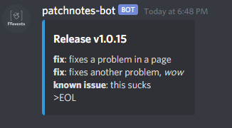

# Discord Notifications

GitHub Action for posting Discord notifications through a webhook when a repository release is published.



## Usage

Create `.github/workflows/discord-release-msg.yml` in your repository:

```yml
name: Post release notification to Discord

on:
  release:
    types: [ published ]

jobs:
  notify:
    name: Post release notification
    runs-on: ubuntu-latest
    steps:
      - name: Send notification
        # Replace COMMIT_SHA with the 40-character SHA of a published Node 24 release commit.
        uses: Kometa-Team/discord-notifications@COMMIT_SHA
        with:
          webhook_id: ${{ secrets.DISCORD_WEBHOOK_ID }}
          webhook_token: ${{ secrets.DISCORD_WEBHOOK_TOKEN }}
```

## Create a Discord webhook

In Discord, open the target channel and select **Edit Channel** > **Integrations** > **Webhooks** > **New Webhook**.

The webhook URL contains both values required by the action:

`https://discord.com/api/webhooks/WEBHOOK_ID/WEBHOOK_TOKEN`

## Configure repository secrets

Store the webhook values as repository secrets so they are not exposed in your workflow. In GitHub, open **Settings** > **Secrets and variables** > **Actions**, then create these repository secrets:

- `DISCORD_WEBHOOK_ID`: the `WEBHOOK_ID` portion of the URL.
- `DISCORD_WEBHOOK_TOKEN`: the `WEBHOOK_TOKEN` portion of the URL.

Each published release will now post a formatted notification to the selected Discord channel.


